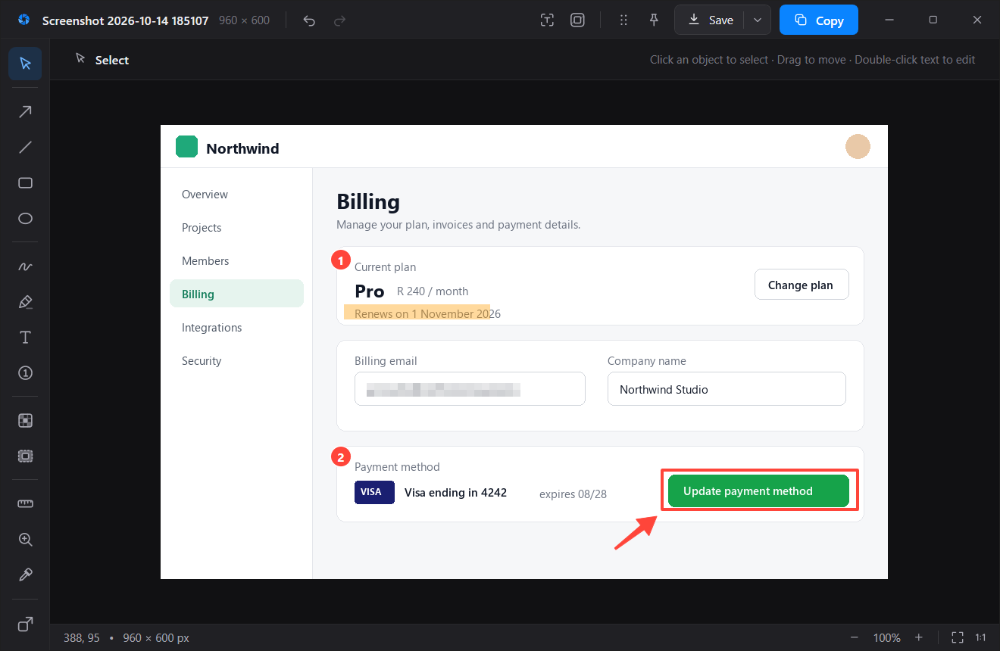
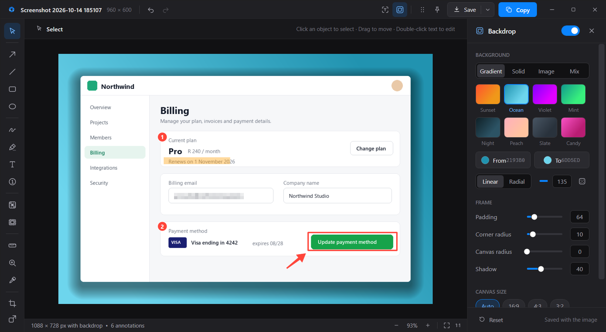
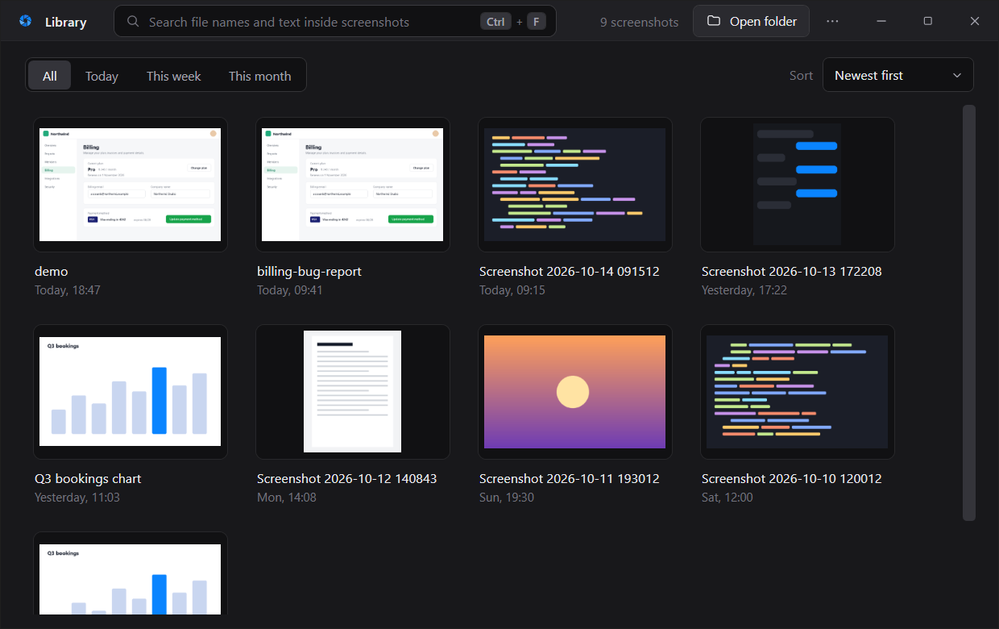
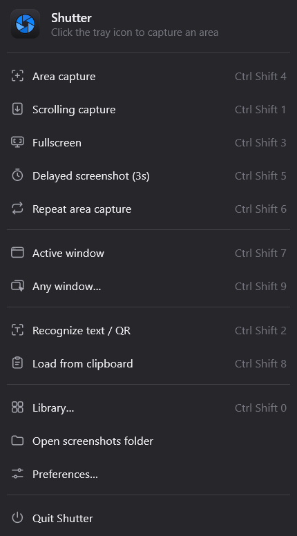
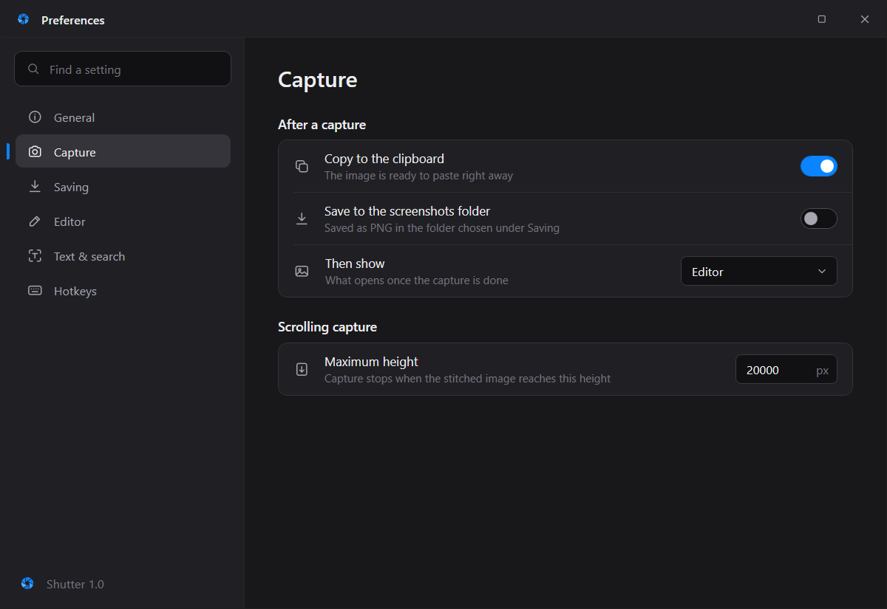
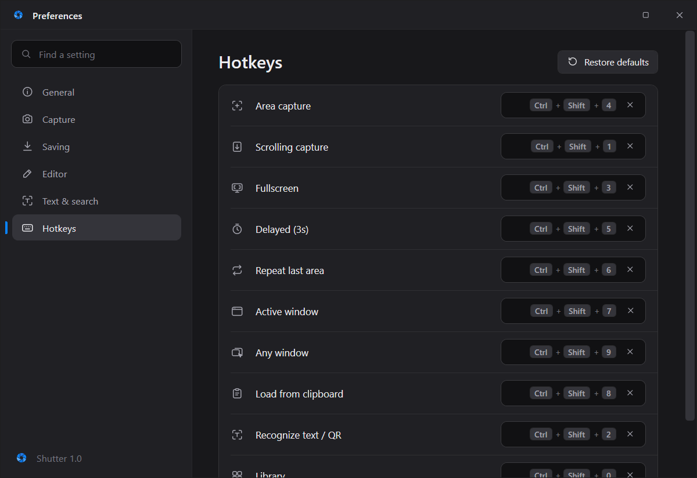

# Shutter

A Windows screenshot and annotation tool for personal use, inspired by Shottr.



## What it can do

### Capture
- **Area capture:** drag a rectangle on a frozen screen, with a live size readout, a pixel loupe and crosshair guides. Hold **Space** to move the selection.
- **Fullscreen:** the screen under your cursor.
- **Active window** and **any window:** hover a window to highlight it, then click to capture just that window.
- **Delayed capture:** a 3-second timer, for menus and hover states.
- **Repeat last area:** capture the same region again with one hotkey.
- **Scrolling capture:** automatically scrolls down or up and stitches the result into one tall image (or scroll by hand in manual mode).
- **Load from clipboard:** open any image you have copied in the editor.
- **Multi-monitor:** each monitor gets its own picker overlay.

### Annotate and edit
- **Shapes:** arrow, line, rectangle, oval, each with outline, soft or solid fill.
- **Pen tools:** freehand and highlighter, plus numbered counters (1, 2, 3...) for step-by-step guides.
- **Text:** click to type directly on the image, with an optional background.
- **Blur / erase:** pixelate a region, or cover it with a solid color. Erase can match the surroundings automatically or use a color you pick.
- **Spotlight:** dim everything outside a rectangle to draw attention.
- **Measuring and picking:** a pixel ruler, a magnifier lens, and a color picker that copies HEX, RGB or HSL.
- **Image tools:** crop and uncrop, resize, undo and redo, and zoom (Ctrl + mouse wheel).
- **Selection:** click any object to move it, resize it from its handles, change its color, or delete it. Every tool has a one-letter shortcut.

### Make it look good
- **Backdrops:** put the screenshot on a gradient, solid color, your own picture, your desktop wallpaper, or a blend of the screenshot's own colors. Adjust padding, corner radius, shadow and canvas shape (16:9, 4:3, 1:1 and more).

### Get text out of images
- **OCR:** drag over any text to copy it, using the text recognition built into Windows. No data leaves your PC.
- **QR codes:** scanned automatically and copied.
- **Searchable library:** the Library can search for words *inside* your saved screenshots.

### Share and keep
- **Copy, save or drag out:** copy to the clipboard, save as PNG or JPEG, or drag the image straight into another app.
- **Pin to screen:** float any image above your other windows. Scroll to resize it, right-click to change its opacity.
- **Library:** browse everything you have saved, with search, date filters, sorting, and quick copy, pin or delete.
- **Preview card:** an optional small card in the corner after each capture, instead of the full editor.

### Fits into your day
- **Tray app:** always ready, with a menu for every action, and global hotkeys that you can change.
- **Private:** everything runs on your PC. There is no account, no upload and no telemetry.
- **Simple install:** one installer, no admin rights, and it starts with Windows if you like.

## Screenshots

### Editor with a backdrop


### Library


### Tray menu


### Preferences and hotkeys



---

## Download and install (no building needed)

**You do not need to build anything.** Just download the installer and run it.

1. Open the **[Releases page](https://github.com/Nanthia/Shutter/releases/latest)**.
2. Under **Assets**, click **`Shutter-Setup-<version>.exe`** (for example `Shutter-Setup-1.0.4.exe`) to download it.
   Ignore the "Source code (zip)" and "Source code (tar.gz)" links; those are for developers.
3. Run the downloaded file. If Windows shows a blue **"Windows protected your PC"** screen (the installer isn't code-signed), click **More info**, then **Run anyway**.
4. Follow the wizard. You can choose a desktop shortcut and whether Shutter starts when you sign in.
5. Shutter runs in the system tray, near the clock (check the hidden-icons arrow if you don't see it). Click the tray icon, or press **Ctrl+Shift+4**, to capture an area.

That's it. The installer includes everything Shutter needs, including the .NET runtime, so there is nothing else to download or install.

**Requirements:** 64-bit Windows 10 (version 2004 or newer) or Windows 11. No admin rights needed.

### Updating, uninstalling, moving to a new PC

- **Update:** run a newer installer over the old one. It closes the running app and keeps your settings.
- **Uninstall:** Windows **Settings > Apps > Installed apps > Shutter**. Your saved screenshots are never deleted.
- **New PC:** install the same way. To bring your settings across, copy `%AppData%\Shutter` (and your screenshots folder, `Pictures\Shutter` by default) from the old PC.

## Default hotkeys

| Action | Hotkey |
| --- | --- |
| Area capture | Ctrl+Shift+4 |
| Scrolling capture | Ctrl+Shift+1 |
| Fullscreen | Ctrl+Shift+3 |
| Delayed (3s) | Ctrl+Shift+5 |
| Repeat last area | Ctrl+Shift+6 |
| Active window | Ctrl+Shift+7 |
| Any window | Ctrl+Shift+9 |
| Load from clipboard | Ctrl+Shift+8 |
| Recognize text / QR | Ctrl+Shift+2 |
| Library | Ctrl+Shift+0 |

All hotkeys can be changed in **Preferences > Hotkeys**. Settings and logs are stored in `%AppData%\Shutter`.

---

## For developers only: building from source

Everyone else can skip this section. It is only needed if you want to change the code and make your own installer.

You need Git, the .NET 8 SDK and [Inno Setup 6](https://jrsoftware.org/isinfo.php):

```powershell
winget install Git.Git Microsoft.DotNet.SDK.8 JRSoftware.InnoSetup
git clone https://github.com/Nanthia/Shutter.git
cd Shutter
.\build.ps1                                          # self-contained exe + installer in installer\output\
dotnet build Shutter\Shutter.csproj -c Release      # or just a quick dev build
```

To publish a new release, bump the version in `Shutter\Shutter.csproj` and `installer\Shutter.iss`, run `.\build.ps1`, then:

```powershell
gh release create v1.0.5 installer\output\Shutter-Setup-1.0.5.exe --title "Shutter 1.0.5" --notes "What changed"
```

### Repository layout

| Path | Contents |
| --- | --- |
| `Shutter/` | The WPF / .NET 8 app |
| `Shutter/Resources/` | Theme tokens, icon geometries, control styles |
| `installer/Shutter.iss` | Inno Setup script (per-user install, no admin) |
| `build.ps1` | Builds the app and the installer |
| `Shutter Redesign/` | UI mockups, icons and brand assets the UI was built from |
| `docs/` | Notes on the original app's structure |
